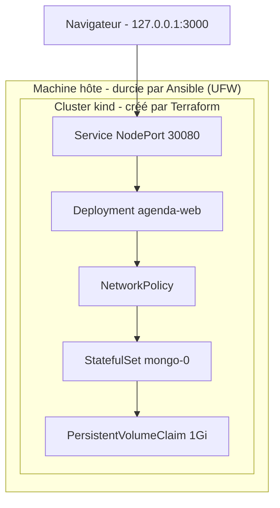

```
      ___           ___           ___                    ___           ___           ___           ___           ___           ___
     /\__\         /\  \         /\__\                  /\  \         /\  \         /\  \         /\__\         /\  \         /\  \
    /::|  |       /::\  \       /::|  |                /::\  \       /::\  \       /::\  \       /::|  |       /::\  \       /::\  \
   /:|:|  |      /:/\:\  \     /:|:|  |               /:/\:\  \     /:/\:\  \     /:/\:\  \     /:|:|  |      /:/\:\  \     /:/\:\  \
  /:/|:|__|__   /:/  \:\  \   /:/|:|  |__            /::\~\:\  \   /:/  \:\  \   /::\~\:\  \   /:/|:|  |__   /:/  \:\__\   /::\~\:\  \
 /:/ |::::\__\ /:/__/ \:\__\ /:/ |:| /\__\          /:/\:\ \:\__\ /:/__/_\:\__\ /:/\:\ \:\__\ /:/ |:| /\__\ /:/__/ \:|__| /:/\:\ \:\__\
 \/__/~~/:/  / \:\  \ /:/  / \/__|:|/:/  /          \/__\:\/:/  / \:\  /\ \/__/ \:\~\:\ \/__/ \/__|:|/:/  / \:\  \ /:/  / \/__\:\/:/  /
       /:/  /   \:\  /:/  /      |:/:/  /                \::/  /   \:\ \:\__\    \:\ \:\__\       |:/:/  /   \:\  /:/  /       \::/  /
      /:/  /     \:\/:/  /       |::/  /                 /:/  /     \:\/:/  /     \:\ \/__/       |::/  /     \:\/:/  /        /:/  /
     /:/  /       \::/  /        /:/  /                 /:/  /       \::/  /       \:\__\         /:/  /       \::/__/        /:/  /
     \/__/         \/__/         \/__/                  \/__/         \/__/         \/__/         \/__/         ~~            \/__/
```

---

# 📅 Mon Agenda – Application Web de Gestion de Calendriers & Rendez-vous

<p align="center">
  
  
  
  
  
  
  
  
</p>

<p align="center">
  
  
  <a href="https://github.com/supeernova10/agenda/actions/workflows/devsecops.yml">
    
  </a>
</p>

---

## 🎯 **Présentation**

**Agenda** est une application web moderne, intuitive et responsive permettant de gérer plusieurs calendriers, organiser des rendez-vous, collaborer avec une équipe et synchroniser ses données via le format **ICS**.

Développée en **Node.js + Express + MongoDB**, elle s'appuie sur **[FullCalendar](https://fullcalendar.io)** pour un rendu interactif, fluide et ergonomique sur ordinateur, tablette et mobile.

---

# ✨ Fonctionnalités

## 🔐 **Authentification & Sécurité**

- Création de compte
- Connexion sécurisée (JWT)
- Modification du profil
- Suppression définitive du compte
- Hashage des mots de passe (bcrypt)
- Middleware d’authentification dédié

---

## 📆 **Gestion avancée des rendez-vous**

- CRUD complet (ajout, modifier, supprimer)
- Déplacement & redimensionnement dans FullCalendar
- Recherche globale
- Rendez-vous récurrents
- Corbeille avec restauration 30 jours
- Jours fériés automatiques selon pays
- Import & export ICS

---

## 🗂️ **Calendriers personnalisés**

- Création / modification / suppression
- Couleur personnalisée
- Affichage parallèle multi-calendriers
- Permissions partagées
- Mode entreprise (accès équipe)

---

## 👥 **Collaboration & Mode Entreprise**

- Partage de calendriers
- Droits d’accès (lecture / écriture)
- Visualisation de disponibilité d’équipe
- Gestion multi-utilisateurs

---

## 📱 **Interface responsive & moderne**

- Compatible ordinateur, tablette, mobile
- Adaptation automatique des vues FullCalendar
- Mode sombre
- Design clean & ergonomique
- Comportements dynamiques (tooltips, interactions directes)

---

# 🏗️ Architecture du projet

```
agenda
│
├── .github/
│   └── workflows/
│       └── devsecops.yml  → pipeline CI (TruffleHog, Semgrep, Trivy image + IaC)
├── ansible/               → deploy.yml (déploiement), hardening.yml (durcissement hôte)
├── docs/                  → documentation projet (backlog, diagrammes, revues)
├── k8s/                   → manifests Kubernetes (app, MongoDB, services, NetworkPolicy)
├── src/
│   ├── controllers/       → logique métier (rendez-vous, calendrier, user…)
│   ├── middleware/        → authentification JWT
│   ├── models/            → schémas Mongoose + connexion DB
│   ├── public/
│   │   ├── css/           → styles globaux et pages (global, agenda, thème…)
│   │   └── js/            → scripts front-end modulaires
│   ├── routes/            → routes Express
│   ├── views/             → pages HTML principales
│   └── server.js          → serveur Express
├── terraform/             → cluster Kubernetes local (kind)
├── Dockerfile             → image de production multi-stage durcie (non-root)
├── ansible.cfg
└── package.json

```

---

# 🛠️ Technologies

### Backend

- Node.js
- Express 5
- MongoDB / Mongoose
- JWT
- bcrypt
- Multer
- node-ical / ICS
- dotenv

### Frontend

- HTML / CSS / JS
- FullCalendar
- Tippy.js
- Thème clair et sombre

---

# 📦 Installation

### 1. Cloner le dépôt

```bash
git clone https://github.com/supeernova10/agenda.git
cd agenda
```

### 2. Installer les dépendances

```bash
npm install
```

### 3. Configurer l'environnement

Créer `.env` :

```
PORT=3000
MONGO_URI=mongodb://localhost:27017/agenda
SECRET_KEY=votre_secret
```

### 4. Lancer l’application

```bash
npm run dev
```

---

# 🧪 Seed Database

```bash
node src/seed.js
node src/seed_rdv.js
```

---

# 📁 Documentation

Le dossier `docs/` contient :

- Backlog produit
- Diagramme UML
- Sprint Reviews
- Rétrospectives
- Tests Effectués

---

# 🖥️ Responsive Preview

| Desktop            | Tablette               | Mobile                       |
| ------------------ | ---------------------- | ---------------------------- |
| ✔️ Support complet | ✔️ Adaptation des vues | ✔️ Mode listWeek automatique |

---

# ☸️ Infrastructure as Code & Kubernetes

L'application est déployée sur un cluster Kubernetes local (kind), entièrement automatisé.



| Outil | Rôle dans le projet |
|---|---|
| **Terraform** | Crée le cluster kind ; le port 3000 n'est exposé que sur `127.0.0.1` |
| **Ansible** | `deploy.yml` : crée le secret, applique les manifests, vérifie `/health` (idempotent) ; `hardening.yml` : pare-feu UFW |
| **Kubernetes** | Exécute l'application et MongoDB (probes, limites de ressources, volume persistant) |

## 🚀 Déployer sur Kubernetes

Prérequis : Docker, kind, kubectl, Terraform, Ansible (`ansible-galaxy collection install kubernetes.core`).


```bash

# 0. Dépendances Ansible
sudo apt install python3-kubernetes python3-yaml
ansible-galaxy collection install kubernetes.core

# 1. Créer le cluster
cd terraform && terraform init && terraform apply -auto-approve && cd ..

# 2. Construire l'image et la charger dans le cluster
docker build -t agenda-app:1.1 .
kind load docker-image agenda-app:1.1 --name agenda-devsecops

# 3. Déployer (secret aléatoire, MongoDB, application)
ansible-playbook ansible/deploy.yml

# 4. (optionnel) Durcir la machine hôte
ansible-playbook ansible/hardening.yml --ask-become-pass
```

Application : http://localhost:3000 — santé : `/health`.
Pour tout supprimer : `cd terraform && terraform destroy`.

---

# 🔒 Sécurité & DevSecOps

### Sécurité Applicative
- Hashage des mots de passe (`bcrypt`)
- Authentification par jetons `JWT` signés et middleware d’accès granulaire
- Validation des entrées back-end et front-end

### Pipeline CI/CD DevSecOps (Shift-Left Security)
À chaque `push` ou `pull_request` sur la branche `main`, un workflow **GitHub Actions** exécute automatiquement les contrôles suivants :

1. **Secret Scanning (`TruffleHog`) :** Détection automatisée de clés API, mots de passe ou jetons exposés dans l'historique Git.
2. **Analyse Statique de Code – SAST (`Semgrep`) :** Audit automatisé du code JavaScript/Node.js (règles OWASP Top 10) et vérification du durcissement du pipeline CI/CD (verrouillage des actions tierces par empreinte SHA-1).
3. **Durcissement du Conteneur (`Docker Multi-Stage`) :**
   - Image de production minimale basée sur `node:22-alpine` mise à jour (`apk upgrade`).
   - Suppression des gestionnaires de paquets (`npm`, `yarn`, `corepack`) dans l'image finale pour réduire la surface d'attaque.
   - Exécution du processus applicatif sous l'utilisateur non-privilégié `node` (non-root).
4. **Scan de Vulnérabilités – SCA & OS (`Trivy`) :** Blocage automatique du build en cas de détection de vulnérabilités `HIGH` ou `CRITICAL` dans les dépendances système ou applicatives.
5. **Scan de l'Infrastructure as Code (`Trivy config`) :** Analyse des manifests Kubernetes, du Terraform et du Dockerfile ; le build échoue en cas de mauvaise configuration `HIGH` ou `CRITICAL`.


---
### Sécurité de l'infrastructure
- Conteneurs non-root, système de fichiers en lecture seule, toutes les capabilities supprimées, élévation de privilèges interdite
- NetworkPolicy : MongoDB n'accepte que le trafic de l'application
- Aucun secret dans Git : le secret Kubernetes est généré par Ansible avec une clé aléatoire (`k8s/secret.exemple.yaml` sert de modèle)
- Port 3000 exposé uniquement sur `127.0.0.1` (Terraform `listen_address`), car Docker contourne UFW pour les ports publiés
- Pare-feu UFW en politique « deny » par défaut sur l'hôte (Ansible)
- Terraform : state et kubeconfig exclus du dépôt
---

### Limites connues
- Cluster local à un seul nœud : pas de haute disponibilité
- MongoDB sans authentification (isolé uniquement par la NetworkPolicy)
- Pas de déploiement continu : le pipeline se limite aux contrôles de sécurité
- Secrets gérés par Ansible, sans coffre externe (Vault, Sealed Secrets)

---
# 👥 Équipe de développement

- [NACHID Ayman](https://github.com/Nachiid)
- KECHICHE Younes
- MEZOUARA Yassir
- MADANE Youssef

> **Mise en place DevSecOps** (pipeline CI, durcissement Docker, Terraform, Ansible, Kubernetes) : [MEZOUARA Yassir](https://github.com/supeernova10)
---

# 📜 Licence

Projet sous licence **MIT**.

---

```
      ___           ___           ___           ___                  ___           ___                         ___
     /__/|         /  /\         /  /\         /  /\                /  /\         /  /\                       /__/\
    |  |:|        /  /:/_       /  /:/_       /  /::\              /  /:/        /  /::\                     |  |::\
    |  |:|       /  /:/ /\     /  /:/ /\     /  /:/\:\            /  /:/        /  /:/\:\    ___     ___     |  |:|:\
  __|  |:|      /  /:/ /:/_   /  /:/ /:/_   /  /:/~/:/           /  /:/  ___   /  /:/~/::\  /__/\   /  /\  __|__|:|\:\
 /__/\_|:|____ /__/:/ /:/ /\ /__/:/ /:/ /\ /__/:/ /:/           /__/:/  /  /\ /__/:/ /:/\:\ \  \:\ /  /:/ /__/::::| \:\
 \  \:\/:::::/ \  \:\/:/ /:/ \  \:\/:/ /:/ \  \:\/:/            \  \:\ /  /:/ \  \:\/:/__\/  \  \:\  /:/  \  \:\~~\__\/
  \  \::/~~~~   \  \::/ /:/   \  \::/ /:/   \  \::/              \  \:\  /:/   \  \::/        \  \:\/:/    \  \:\
   \  \:\        \  \:\/:/     \  \:\/:/     \  \:\               \  \:\/:/     \  \:\         \  \::/      \  \:\
    \  \:\        \  \::/       \  \::/       \  \:\               \  \::/       \  \:\         \__\/        \  \:\
     \__\/         \__\/         \__\/         \__\/                \__\/         \__\/                       \__\/
```

```

                                                   ___           ___                            
                                                  /\  \         /\  \         _____             
                                                 /::\  \        \:\  \       /::\  \            
                                                /:/\:\  \        \:\  \     /:/\:\  \           
                                               /:/ /::\  \   _____\:\  \   /:/  \:\__\          
                                              /:/_/:/\:\__\ /::::::::\__\ /:/__/ \:|__|         
                                              \:\/:/  \/__/ \:\~~\~~\/__/ \:\  \ /:/  /         
                                               \::/__/       \:\  \        \:\  /:/  /          
                                                \:\  \        \:\  \        \:\/:/  /           
                                                 \:\__\        \:\__\        \::/  /            
                                                  \/__/         \/__/         \/__/             
```

```
      ___           ___           ___           ___          _____          ___                         ___
     /  /\         /  /\         /__/\         /  /\        /  /::\        /__/\                       /  /\
    /  /:/_       /  /:/         \  \:\       /  /:/_      /  /:/\:\       \  \:\                     /  /:/_
   /  /:/ /\     /  /:/           \__\:\     /  /:/ /\    /  /:/  \:\       \  \:\    ___     ___    /  /:/ /\
  /  /:/ /::\   /  /:/  ___   ___ /  /::\   /  /:/ /:/_  /__/:/ \__\:|  ___  \  \:\  /__/\   /  /\  /  /:/ /:/_
 /__/:/ /:/\:\ /__/:/  /  /\ /__/\  /:/\:\ /__/:/ /:/ /\ \  \:\ /  /:/ /__/\  \__\:\ \  \:\ /  /:/ /__/:/ /:/ /\
 \  \:\/:/~/:/ \  \:\ /  /:/ \  \:\/:/__\/ \  \:\/:/ /:/  \  \:\  /:/  \  \:\ /  /:/  \  \:\  /:/  \  \:\/:/ /:/
  \  \::/ /:/   \  \:\  /:/   \  \::/       \  \::/ /:/    \  \:\/:/    \  \:\  /:/    \  \:\/:/    \  \::/ /:/
   \__\/ /:/     \  \:\/:/     \  \:\        \  \:\/:/      \  \::/      \  \:\/:/      \  \::/      \  \:\/:/
     /__/:/       \  \::/       \  \:\        \  \::/        \__\/        \  \::/        \__\/        \  \::/
     \__\/         \__\/         \__\/         \__\/                       \__\/                       \__\/

```

---
